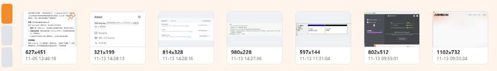
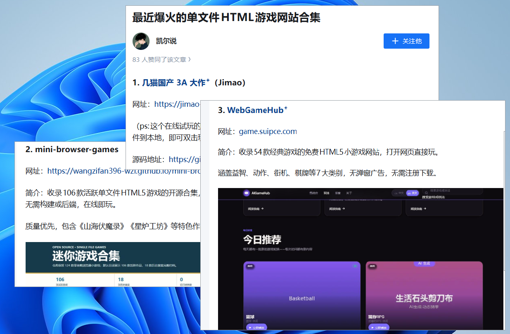
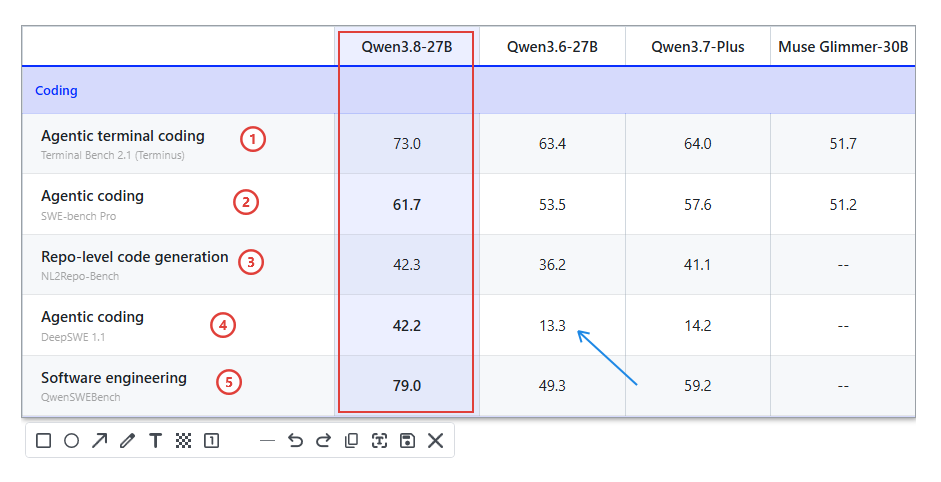
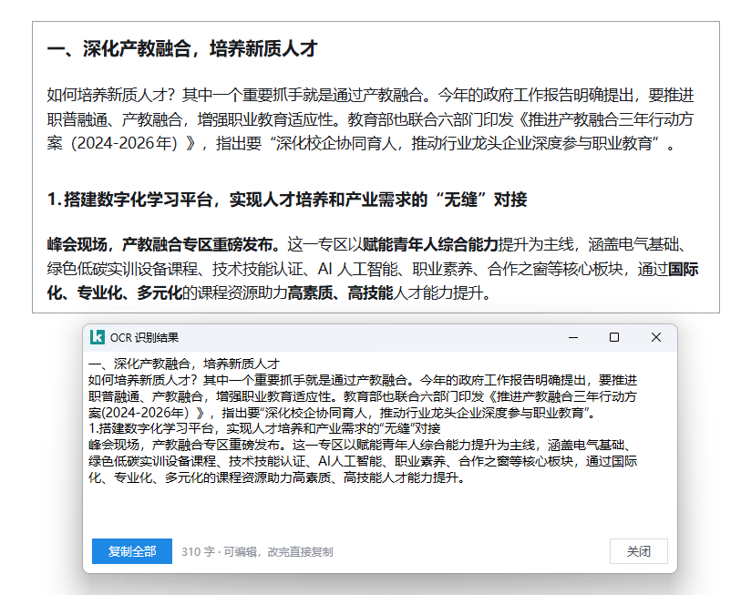
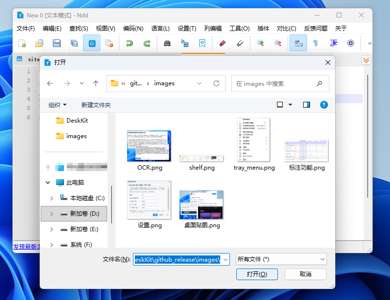

# DeskKit 桌面工具箱

Windows 桌面效率工具箱：**截图贴图 / 剪贴板暂存架 / OCR 识文 / 局域网互传**，一个托盘常驻程序全搞定。

<div align="center">

[](../../releases/latest)
[](../../stargazers)
[](LICENSE)
[](https://www.microsoft.com/windows)
[](https://dotnet.microsoft.com/zh-cn/download/dotnet/8.0)
[](#截图与-ocr)

[下载最新版](../../releases/latest) · [功能](#功能一览) · [使用](#快速上手) · [构建](#从源码构建) · [常见问题](#常见问题)

</div>



托盘右键菜单——所有功能一目了然，截图 / 暂存架 / 开关 / 配置按功能分组：


## 功能一览

- **剪贴板暂存架**：截图、图片、文字、文件统一收纳，鼠标靠近屏幕边缘即滑出，支持图钉贴图、磁盘缓存、自动保存
- **截图贴图**：区域/窗口截图、全屏截到剪贴板、剪贴板贴图置顶于任意窗口之上，标注工具齐全
- **OCR 识文**：PP-OCRv5 本地离线识别，截图直接出文字，中英文混排准确率高
- **快捷跳转**：Ctrl+G 快速跳转对话框中的按钮
- **粘贴即存**：资源管理器里 Ctrl+V 把剪贴板图片/文字直接存成文件
- **网络传输**：手机/电脑浏览器扫码即传；DeskKit 设备之间互发文字、图片、文件并聊天；首次连接需宿主确认，支持 Tailscale 跨网段

## 快速上手

启动后程序常驻托盘，鼠标靠近屏幕边缘滑出暂存架。核心操作：

### 暂存架

| 操作 | 说明 |
|---|---|
| 鼠标靠近屏幕边缘 | 暂存架滑出；移开自动收回 |
| 点击条目 | 内容回到剪贴板（图片/文字直接可用） |
| 拖住条目到屏幕边缘 | 贴图：图片置顶悬浮于所有窗口之上，可缩放/标注 |
| 三种轨道 | 图 / 文 / 设备分轨道收纳，互不干扰 |
| 自动保存 | 截图自动落盘，缓存重启不丢 |

贴图效果——拖住条目到屏幕边缘，截图即置顶悬浮于所有窗口之上，可缩放、可多张叠加：



### 截图与 OCR

| 快捷键 | 功能 |
|---|---|
| `F1` | 区域/窗口截图 |
| `Ctrl+Shift+C` | 全屏截到剪贴板 |
| `Ctrl+Alt+V` | 剪贴板内容贴图 |
| `Ctrl+G` | 快捷跳转 |

F1 呼出截图后，工具条提供矩形 / 圆 / 箭头 / 画笔 / 文字等标注工具，框选序号一步到位：



截图后工具条上点「识文」即 OCR——全部本地离线，不上传任何数据，结果可直接编辑复制：



`Ctrl+G` 快捷跳转——不用鼠标翻菜单，对话框里的目标按钮一键直达：



### 网络传输

- 手机/电脑浏览器访问窗口/托盘显示的 `http://ip:端口`（可扫码），即可双向传文件
- 两台装了 DeskKit 的设备：设置 → 网络传输 → 填对方地址即互连，之后可聊天、传文件；连接过的设备每次启动自动重连
- 陌生设备首次连接会在宿主机弹窗确认，同意后记住，不再询问

设备之间聊天、互发图片和文件（收到的文件点气泡直达所在目录）：


全部配置集中在设置窗（含外观、贴图、暂存、长截图、快捷键、传输等分页），热键即改即生效，冲突自动回滚不会保存坏值：


## 下载

不想自己编译的，前往 [Releases](../../releases) 下载打包好的 zip，解压即用。

**系统要求**：Windows 10/11 x64 + [.NET 8 Desktop Runtime](https://dotnet.microsoft.com/zh-cn/download/dotnet/8.0)，约 100 MB 磁盘（含 OCR 模型）。

## 从源码构建

```bash
# 需要 .NET 8 SDK（含 Windows Desktop 组件）
dotnet publish DeskKit/DeskKit.csproj -c Release -o publish
```

产物在 `publish/`：单文件 exe + 原生 DLL（onnxruntime / libSkiaSharp）+ `models\v5\` OCR 模型 + `Help.md`。

OCR 识别模型为 PP-OCRv5 中文模型（Apache-2.0，随仓库分发）；det/cls 模型由 RapidOcrNet NuGet 包在构建时自动拷入。

## 详细帮助

完整使用说明见 [`DeskKit/Docs/Help.md`](DeskKit/Docs/Help.md)（程序内托盘右键 → 帮助 可随时打开），含全部设置项、快捷键总表与 FAQ。

## 常见问题

- **SmartScreen 提示"已保护你的电脑"**：程序未做代码签名，点击"更多信息 → 仍要运行"即可
- **截图热键无效**：多为 PixPin/Snipaste 等同类工具抢注了热键，关掉对方或在本程序设置里换键
- **OCR 需要联网吗**：不需要，模型随程序本地运行

## 开源组件声明

| 组件 | 许可证 |
|---|---|
| RapidOcrNet | Apache License 2.0 |
| PaddleOCR PP-OCRv5 识别模型 | Apache License 2.0 |
| ONNX Runtime | MIT License |
| QRCoder | MIT License |
| SkiaSharp | MIT License |
| .NET 8 | MIT License |

## 许可

本程序源码以 [GPL-3.0](LICENSE) 协议开源——任何基于本代码的衍生作品再发布时必须同样以 GPL-3.0 公开源码。
