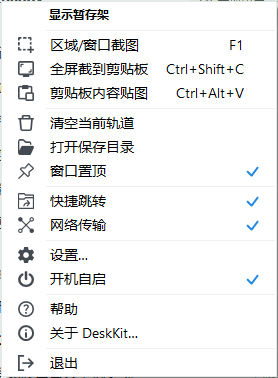
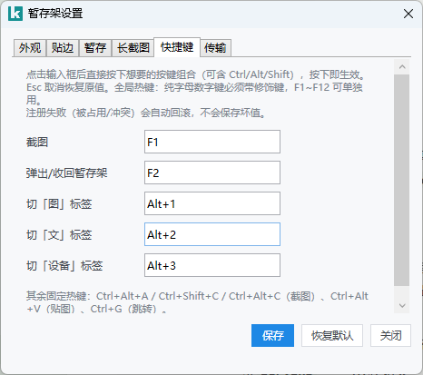

# DeskKit 桌面工具箱

Windows 桌面效率工具箱：**截图贴图 / 剪贴板暂存架 / OCR 识文 / 局域网互传**，一个托盘常驻程序全搞定。

<div align="center">

[](../../releases/latest)
[](../../stargazers)
[](LICENSE)
[](https://www.microsoft.com/windows)
[](https://dotnet.microsoft.com/zh-cn/download/dotnet/8.0)
[](#ocr-识文)

[下载最新版](../../releases/latest) · [功能详解](#功能详解) · [快捷键](#键盘快捷键) · [更新日志](CHANGELOG.md) · [构建](#从源码构建) · [常见问题](#常见问题)

</div>

---

## 界面一览

<p align="center"></p>
<p align="center"><sub>暂存架常驻屏幕边缘：鼠标靠近即滑出，移开自动收回，不占任务栏</sub></p>

<p align="center"></p>
<p align="center"><sub>托盘右键菜单：截图 / 暂存架 / 开关 / 配置按功能分组，一目了然</sub></p>

---

## 功能详解

### 剪贴板暂存架

复制过的截图、图片、文字、文件都收在这里。暂存架平时缩在屏幕边缘只露一条，鼠标靠近滑出、移开收回——**不弹窗、不抢焦点、不占任务栏**，找回十分钟前复制的内容只需一次靠近。

| 操作 | 说明 |
|---|---|
| 鼠标靠近屏幕边缘 | 暂存架滑出；移开自动收回 |
| 点击条目 | 内容回到剪贴板（图片/文字直接可粘贴） |
| 拖住条目到屏幕边缘 | 贴图：图片置顶悬浮于所有窗口之上 |
| 三种轨道 | 图 / 文 / 设备分轨道收纳，互不干扰 |
| 自动保存 | 截图自动落盘，位置可在设置中修改 |

- **磁盘缓存**：开启后重启不丢，历史内容都在
- **自动清理**：每日零点自动清理过期条目，暂存架不会越积越多

### 截图与标注

按 `F1` 框选即截，窗口边缘自动吸附识别；截完直接进入标注，工具条提供矩形 / 圆 / 箭头 / 画笔 / 文字 / 序号圈等工具，颜色粗细可调——汇报配图、圈重点一步到位。

<p align="center"></p>

| 快捷键 | 功能 |
|---|---|
| `F1` | 区域 / 窗口截图 |
| `Ctrl+Shift+C` | 全屏截到剪贴板 |
| `Ctrl+Alt+V` | 剪贴板内容贴图 |

### 贴图（Pin）

把截图或剪贴板里的图片**钉在桌面上**——置顶悬浮于所有窗口之上，支持多张共存、滚轮缩放、再次标注。对照着别处的界面抄数据、核对信息时特别顺手，不用来回切换窗口。

<p align="center"></p>

### OCR 识文

截图工具条上点「识文」，PP-OCRv5 模型直接出文字，中英文混排识别准确率高。

- **完全本地离线**：模型随程序分发，识别过程不上传任何数据，截图内容不出机器
- 结果面板可编辑，「复制全部」一键取走

<p align="center"></p>

### 快捷跳转（Ctrl+G）

Listary 风格的目录直达：在**任意程序**的「打开 / 另存为」文件对话框里按 `Ctrl+G`，对话框自动跳转到你最近在资源管理器浏览的文件夹。

**典型场景**：

1. 在资源管理器里浏览到 `D:\项目\截图`
2. 回到软件里点「打开文件」——对话框默认停在别的目录
3. 按 `Ctrl+G`——对话框立即跳到 `D:\项目\截图`，不用一层层点进去

支持传统对话框与 Win10/11 新式对话框，Chrome / Edge 等浏览器内嵌的文件选择框同样有效。

<p align="center"></p>

### 网络传输

电脑、手机、平板之间互发文字 / 图片 / 文件，**无需数据线**：

- **扫码即传**：手机浏览器访问窗口显示的地址（可扫码），直接把照片、文件传到电脑
- **设备互连**：两台装了 DeskKit 的设备在设置里填对方地址即互连，之后可聊天、互发文件，收到的文件点气泡直达所在目录
- **安全机制**：陌生设备首次连接会在宿主机弹窗确认，同意后记住不再询问；连接过的设备每次启动自动重连
- **跨网段**：支持 Tailscale，不在同一局域网也能传

<p align="center"></p>

### 设置

所有配置集中在一处：外观、贴图、暂存、长截图、快捷键、传输等分页。热键即改即生效，冲突自动回滚，不会保存坏值。

<p align="center"></p>

---

## 键盘快捷键

| 快捷键 | 功能 |
|---|---|
| `F1` | 区域 / 窗口截图 |
| `Ctrl+Shift+C` | 全屏截到剪贴板 |
| `Ctrl+Alt+V` | 剪贴板内容贴图 |
| `Ctrl+G` | 快捷跳转（文件对话框直达资源管理器目录） |

> 全局热键与其它软件冲突时（常见如 PixPin / Snipaste 抢注），去 设置 → 快捷键 换键即可，即改即生效。

## 下载

不想自己编译的，前往 [Releases](../../releases) 下载打包好的 zip，解压即用。

**系统要求**：Windows 10/11 x64 + [.NET 8 Desktop Runtime](https://dotnet.microsoft.com/zh-cn/download/dotnet/8.0)，约 100 MB 磁盘（含 OCR 模型）。

## 从源码构建

```bash
# 需要 .NET 8 SDK（含 Windows Desktop 组件）
dotnet publish DeskKit/DeskKit.csproj -c Release -o publish
```

产物在 `publish/`：单文件 exe + 原生 DLL（onnxruntime / libSkiaSharp）+ `models\v5\` OCR 模型 + `Help.md`。

OCR 识别模型为 PP-OCRv5 中文模型（Apache-2.0，随仓库分发）；det/cls 模型由 RapidOcrNet NuGet 包在构建时自动拷入。

## 详细帮助

完整使用说明见 [`DeskKit/Docs/Help.md`](DeskKit/Docs/Help.md)（程序内托盘右键 → 帮助 可随时打开），含全部设置项、快捷键总表与 FAQ。

## 常见问题

- **SmartScreen 提示"已保护你的电脑"**：程序未做代码签名，点击"更多信息 → 仍要运行"即可
- **截图热键无效**：多为 PixPin/Snipaste 等同类工具抢注了热键，关掉对方或在本程序设置里换键
- **OCR 需要联网吗**：不需要，模型随程序本地运行

## 开源组件声明

| 组件 | 许可证 |
|---|---|
| RapidOcrNet | Apache License 2.0 |
| PaddleOCR PP-OCRv5 识别模型 | Apache License 2.0 |
| ONNX Runtime | MIT License |
| QRCoder | MIT License |
| SkiaSharp | MIT License |
| .NET 8 | MIT License |

## 许可

本程序源码以 [GPL-3.0](LICENSE) 协议开源——任何基于本代码的衍生作品再发布时必须同样以 GPL-3.0 公开源码。
