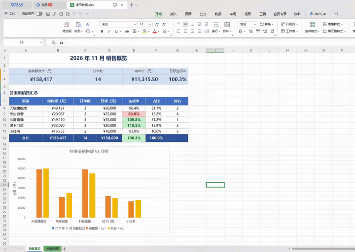
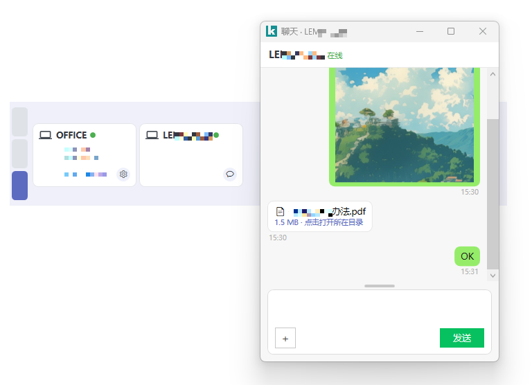

# DeskKit 桌面工具箱

**Windows 桌面效率工具：截图贴图、剪贴板暂存架、本地 OCR、局域网互传——一个托盘程序全搞定。**

| 功能 | 一句话说明 |
|---|---|
| **截图贴图** | `F1` 框选并标注（矩形/箭头/画笔/文字/长截图/吸管取色），图片钉在桌面置顶悬浮 |
| **剪贴板暂存架** | 复制过的图/文自动收纳，贴屏幕边缘随用随取，`Ctrl`+滚轮切轨道 |
| **桌面便签** | 卡片拖到桌面即变贴图或**可编辑便利贴**，改动实时回写暂存架；右键换色/字号/不透明度 |
| **固定堆** | 常用内容固定置顶，级联叠放只露边条，滚轮掀开查看，拖进去即固定 |
| **本地 OCR** | PP-OCRv5 中英文离线识别，结果可编辑复制，截图内容不上传 |
| **局域网互传** | 手机扫码即传文件；两台电脑互连后聊天、互发文件；支持 Tailscale 跨网段 |
| **快捷跳转** | 任意程序的「打开/另存为」对话框按 `Ctrl+G`，跳到资源管理器当前目录 |

Windows 10/11 x64 · 需 .NET 8 桌面运行时 · 免费开源（GPL-3.0）

<!-- ✏️ TODO：建议补一张最能代表软件的截图（GIF 或 PNG）放在这段功能表下方，
     参考优秀项目的做法：首屏让访客 3 秒内看懂软件是干什么的。
     放好后删除本注释。建议内容：暂存架滑出 + 截图标注 + 桌面贴图 同屏演示 GIF -->

<div align="center">

[](../../releases/latest)
[](../../stargazers)
[](LICENSE)
[](https://www.microsoft.com/windows)
[](https://dotnet.microsoft.com/zh-cn/download/dotnet/8.0)
[](#-ocr-识文)

[下载最新版](../../releases/latest) · [主要功能](#-主要功能) · [如何使用](#-如何使用) · [快捷键](#️-快捷键) · [更新日志](CHANGELOG.md) · [构建](#-从源码构建) · [常见问题](#-常见问题)

</div>

---

## ✨ 主要功能

### 📋 剪贴板暂存架

复制过的截图、图片、文字自动收纳，图 / 文 / 设备三条轨道分开存放。暂存架平时缩在屏幕边缘，鼠标靠近滑出、移开收回——找回十分钟前复制的内容只需一次靠近。

<p align="center"></p>
<p align="center"><sub>暂存架常驻屏幕边缘：鼠标靠近即滑出，移开自动收回，不占任务栏</sub></p>

- **点击即预览**：图片可缩放查看，文字可全选复制
- **`Ctrl` + 滚轮**：在暂存架内任意位置切换 图 / 文 / 设备 三条轨道
- **不丢**：磁盘缓存开启后重启不丢；每日零点自动清理过期条目

<p align="center"></p>
<p align="center"><sub>贴边吸附滑出 + Ctrl 滚轮切换 图 / 文 / 设备 标签（15s）· <a href="images/shelf-tabs.mp4">原始录屏</a></sub></p>

### 🗒 桌面便签（拖出即用）

把暂存架里的卡片**直接拖到桌面**，松手就地变成便签——不用先复制、再找地方粘贴：

- **图片卡 → 桌面贴图**：等同于截图贴图，落在光标中心，可缩放、可再标注
- **文字卡 → 可编辑便利贴**：黄色便签样式，点进去就能改文字，**改动实时回写暂存架**里那张卡
- **便签随手调**：拖动顶部窄条移动位置、悬停右上角出现 ✕ 关闭、按住拖动时可按 `Esc` 取消
- **右键设置**：便签颜色（系统取色器，深色底自动转浅色文字）、文字字号（12–20px）、不透明度（100%–60%），每张便签可单独设置

拖拽全程有跟随光标的悬浮幽灵卡片 + “松手 → 贴成便签”提示，松手位置就是落点。

<p align="center"></p>
<p align="center"><sub>复制文字 → 拖出成便签 → 就地改文字 → 右键设颜色 / 字号 / 不透明度（56s，2× 加速）· <a href="images/text-note.mp4">原始录屏</a></sub></p>

### 📌 固定堆

常用内容固定后排在轨道最前，多张固定卡**级联叠放只露边条**，堆顶角标显示固定数量：

- **拖进去就固定**：把未固定的卡拖到固定堆上松手，立即固定并成为堆顶卡
- **滚轮掀卡**：在堆上滚动，逐张掀开查看（下滚=更新的卡，上滚=更早的卡，到头即停不循环）
- **悬停上顶**：鼠标移到任一固定卡的露边，该卡立即完整上顶；移开自动恢复原状
- **误删保护**：固定卡的删除需二次确认

### ✂️ 截图 / 标注

框选即截，窗口边缘自动吸附识别；矩形 / 圆 / 箭头 / 画笔 / 文字 / 序号圈等标注工具，颜色粗细可调；**长截图**支持滚动拼接，适合长网页、长聊天记录。

<p align="center"></p>

- **十字准星**：放大镜中央带 24px 准星（白线+深色描边），亮暗背景都看得清
- **吸管取色**：工具条内置吸管，实时跟随鼠标显示坐标与色值；按 `C` 复制当前颜色值，`Shift` 切换 `rgb(r,g,b)` / `#RRGGBB` 格式（贴图工具条同样内置）

<p align="center"></p>
<p align="center"><sub>框选 → 窗口吸附 → 标注 / 马赛克 → 贴图（38s，2× 加速）· <a href="images/capture.mp4">原始录屏</a></sub></p>

### 📌 贴图

截图或剪贴板图片钉在桌面上置顶悬浮，对照抄数据不用切窗口；滚轮缩放、可再标注。

<p align="center"></p>

- **落位准**：拖出便签与 `Ctrl+Alt+V` 贴图都以**光标为中心**落位（按屏幕 DPI 精确换算）
- **不重复**：同图已在暂存架时不再重复收录，直接选中已有那张
- **外观可调**：边框颜色与粗细、阴影开关/模糊/偏移/浓度，设置改动对**已打开的贴图**立即生效

### 🔍 OCR 识文

PP-OCRv5 模型**完全本地离线**，中英文混排识别，结果可编辑、一键复制，截图内容不上传。

<p align="center"></p>

### 🌐 局域网互传

电脑、手机、平板之间互发文字 / 图片 / 文件，无需数据线：手机扫码即传；两台装了 DeskKit 的设备互连后可聊天、互发文件；陌生设备首次连接弹窗确认；支持 Tailscale 跨网段。

<p align="center"></p>

### 🔗 快捷跳转（Ctrl+G）

Listary 风格：在**任意程序**的「打开 / 另存为」对话框里按 `Ctrl+G`，自动跳到你最近在资源管理器浏览的文件夹，不用一层层点。

<p align="center"></p>

### ⚙️ 设置

外观、贴图、暂存、长截图、快捷键、传输集中在设置窗口；改动**自动保存**并实时生效（无需点保存），热键即改即生效、冲突自动回滚。传输设置也已内嵌在「传输」页，不再单独弹窗。

<p align="center"></p>

<!-- ✏️ TODO：设置窗口已改为卡片式分组布局、悬浮细滚动条，旧图与新界面有出入，建议重截替换。 -->


### 托盘菜单

截图 / 暂存架 / 开关 / 配置按功能分组，一目了然。

<p align="center"></p>

## 🚀 如何使用

### 1. 安装启动

前往 [Releases](../../releases/latest) 下载 zip，解压后运行 `DeskKit.exe`（需 .NET 8 Desktop Runtime）。程序启动后缩在托盘，暂存架自动贴在屏幕边缘。

<!-- ✏️ TODO：确认安装包形态。当前 Release 附件是 zip（免安装），是否考虑提供
     安装器 / scoop / winget？如暂时只有 zip，可删除本注释。 -->

### 2. 日常三步

| 场景 | 操作 |
|---|---|
| **截图** | 按 `F1` 框选（默认键），松手进标注，工具条上选择保存 / 复制 / 贴图 / 识文 / 取色 |
| **贴图** | 截图工具条点「贴图」，或任意界面按 `Ctrl+Alt+V` 把剪贴板图片钉在桌面上；图片落在光标处，贴图上滚轮缩放、可再标注 |
| **找回内容** | 鼠标靠近屏幕边缘 → 暂存架滑出 → 点击条目复制、拖到桌面变便签/贴图 |

### 3. 暂存架进阶

- **固定**：卡片右上角 📌 固定；或直接把未固定的卡**拖到固定堆上**松手
- **查看固定堆**：滚轮在堆上逐张掀开，鼠标悬停露边即可上顶某张；移开自动恢复
- **便签**：文字卡拖出桌面变成黄色便利贴，直接编辑，内容实时同步回暂存架；右键便签可换颜色 / 字号 / 不透明度
- **切标签**：`Ctrl + 滚轮` 在暂存架内任意位置切换 图 / 文 / 设备 轨道

### 4. 传文件

托盘右键 → 传输，或直接把手机浏览器指向窗口显示的网址（可扫码）：

<!-- ✏️ TODO：此处建议补一张"手机端访问传输页"截图。放好后删除本注释。 -->

1. 电脑端打开传输页，显示服务地址与二维码
2. 手机扫码或输入地址 → 直接上传照片 / 文件到电脑
3. 两台电脑互连：设置 → 传输 → 连接其它电脑，填对方地址即可，之后可互发消息与文件

更多细节（全部设置项、各功能进阶用法）见 [`DeskKit/Docs/Help.md`](DeskKit/Docs/Help.md)，程序内托盘右键 → 帮助 可随时打开。

## ⌨️ 快捷键

| 快捷键 | 功能 |
|---|---|
| `F1`（可改） | 区域 / 窗口截图 |
| `Ctrl+Shift+C` | 全屏截到剪贴板 |
| `Ctrl+Alt+C` | 全屏截到剪贴板（备用键） |
| `Ctrl+Alt+A` | 区域截图（备用键） |
| `Ctrl+Alt+V` | 剪贴板内容贴图（图片落在光标处） |
| `Ctrl+G` | 快捷跳转（文件对话框直达资源管理器目录） |

> 截图 / 暂存架 / 标签切换热键均可在 设置 → 快捷键 修改，即改即生效、冲突自动回滚。
> 与其它软件冲突时（常见如 PixPin / Snipaste 抢注），换键即可。

<!-- ✏️ TODO：暂存架弹出/收回与三个标签键的默认键位请确认后补进表格
     （代码里这三组是用户可配置的默认值，我没有把握写对，避免误导用户）。 -->

### 应用内手势速查

| 手势 | 功能 |
|---|---|
| 卡片拖出暂存架 | 图片 → 贴图；文字 → 可编辑便签（`Esc` 取消） |
| 未固定卡拖到固定堆 | 立即固定，成为堆顶卡 |
| 固定堆上滚轮 | 逐张掀开查看（下滚=更新，上滚=更早，到头即停） |
| `Ctrl + 滚轮` | 切换 图 / 文 / 设备 标签 |

## ⬇️ 下载

前往 [Releases](../../releases) 下载打包好的 zip，解压即用。

**系统要求**：Windows 10/11 x64 + [.NET 8 Desktop Runtime](https://dotnet.microsoft.com/zh-cn/download/dotnet/8.0)，约 100 MB 磁盘（含 OCR 模型）。

## 🛠 从源码构建

```bash
# 需要 .NET 8 SDK（含 Windows Desktop 组件）
dotnet publish DeskKit/DeskKit.csproj -c Release -o publish
```

产物在 `publish/`：单文件 exe + 原生 DLL（onnxruntime / libSkiaSharp）+ `models\v5\` OCR 模型 + `Help.md`。

OCR 识别模型为 PP-OCRv5 中文模型（Apache-2.0，随仓库分发）；det/cls 模型由 RapidOcrNet NuGet 包在构建时自动拷入。

## ❓ 常见问题

- **SmartScreen 提示"已保护你的电脑"**：程序未做代码签名，点击"更多信息 → 仍要运行"即可
- **截图热键无效**：多为 PixPin/Snipaste 等同类工具抢注了热键，关掉对方或在本程序设置里换键
- **OCR 需要联网吗**：不需要，模型随程序本地运行，截图内容不出机器
- **重启后暂存架内容还在吗**：开启 设置 → 暂存 → 磁盘缓存 即可重启恢复

## 🧩 开源组件声明

| 组件 | 许可证 |
|---|---|
| RapidOcrNet | Apache License 2.0 |
| PaddleOCR PP-OCRv5 识别模型 | Apache License 2.0 |
| ONNX Runtime | MIT License |
| QRCoder | MIT License |
| SkiaSharp | MIT License |
| .NET 8 | MIT License |

## 📄 许可

本程序源码以 [GPL-3.0](LICENSE) 协议开源——任何基于本代码的衍生作品再发布时必须同样以 GPL-3.0 公开源码。
